# Full Master System Flowchart — Omni Virtual Solutions

This document presents the complete, end-to-end operational flowchart of the entire Omni Virtual Solutions platform. It maps the interactions between visitors, administrators, the security gatekeeper, the dual-runtime server (Node.js & Cloudflare Edge), the real-time SSE engine, the email daemon, and the hybrid database layer.

---

## 1. Master System Flowchart (End-to-End Operational Lifecycle)

```mermaid
flowchart TD
    %% ─────────────────────────────────────────────────────────────
    %% STYLES & CLASSES
    %% ─────────────────────────────────────────────────────────────
    classDef visitorStyle fill:#0f172a,stroke:#38bdf8,stroke-width:2px,color:#f8fafc;
    classDef adminStyle fill:#1e1b4b,stroke:#c084fc,stroke-width:2px,color:#f8fafc;
    classDef securityStyle fill:#450a0a,stroke:#f87171,stroke-width:2px,color:#f8fafc;
    classDef apiStyle fill:#064e3b,stroke:#34d399,stroke-width:2px,color:#f8fafc;
    classDef emailStyle fill:#451a03,stroke:#fbbf24,stroke-width:2px,color:#f8fafc;
    classDef dbStyle fill:#2e1065,stroke:#a78bfa,stroke-width:2px,color:#f8fafc;
    classDef decisionStyle fill:#1f2937,stroke:#94a3b8,stroke-width:2px,color:#f8fafc;

    %% ─────────────────────────────────────────────────────────────
    %% ACTORS / ENTRY POINTS
    %% ─────────────────────────────────────────────────────────────
    subgraph Users["Entry Actors & Browsers"]
        Visitor(["Public Visitor / Client"]):::visitorStyle
        AdminUser(["Administrator / Editor"]):::adminStyle
        ExtEmailUser(["Client Email Client (Gmail/Outlook)"]):::emailStyle
    end

    %% ─────────────────────────────────────────────────────────────
    %% EDGE & GATEKEEPER
    %% ─────────────────────────────────────────────────────────────
    subgraph Gateway["Edge Network & Security Gatekeeper"]
        ReqEntry{"Incoming HTTP Request"}:::decisionStyle
        SecCheck{"Is Path Sensitive?<br/>(.env, /data, .git, .sqlite, source)"}:::decisionStyle
        Block403["Reject: 400/403 Forbidden"]:::securityStyle
        AssetCheck{"Is Static Asset?<br/>(/assets, .webp, .css, .js)"}:::decisionStyle
        EdgeCacheCheck{"Edge Cache Hit?"}:::decisionStyle
        ServeStaticEdge["Serve from Edge Cache (1-Year Immutable)"]:::apiStyle
        IsUploadPath{"Is /assets/uploads/:file?"}:::decisionStyle
        StreamBlobDB["Query Database media_files BLOB & Stream Buffer"]:::dbStyle
        ServeStaticDisk["Serve from /assets Disk"]:::apiStyle
    end

    %% ─────────────────────────────────────────────────────────────
    %% PUBLIC VISITOR FLOW
    %% ─────────────────────────────────────────────────────────────
    subgraph PublicFlow["Public Visitor Experience & Real-Time Sync"]
        LoadHTML["Load index.html / services.html or React SPA"]:::visitorStyle
        BootClientEngine["Execute cms-sync.js & CmsContext"]:::visitorStyle
        FetchSiteMeta["GET /api/v1/site-meta"]:::visitorStyle
        HydrateDOM["Hydrate All [data-block-key] Nodes in DOM"]:::visitorStyle
        OpenSSEConn["Connect EventSource('/api/v1/live')"]:::visitorStyle
        
        BrowseServices["Browse 131-Item Services Catalog"]:::visitorStyle
        SubmitContact["Submit Contact / Lead Form"]:::visitorStyle
        HoneypotCheck{"Bot Triggered?<br/>(website filled OR submit < 300ms)"}:::decisionStyle
        Silent200["Return Fake 200 OK (Discard Spam)"]:::securityStyle
        ValidateLead{"Valid Email & Inputs?"}:::decisionStyle
        ValidationFail["Return 400 Validation Error"]:::securityStyle
        SaveSubmission["INSERT INTO contact_submissions (status = 'new')"]:::dbStyle
        
        SendTelemetry["POST /api/v1/track-visit (Privacy Deduplicated)"]:::visitorStyle
        RecordVisit["INSERT INTO site_visits"]:::dbStyle
    end

    %% ─────────────────────────────────────────────────────────────
    %% ADMIN & CMS WORKFLOW
    %% ─────────────────────────────────────────────────────────────
    subgraph AdminFlow["Admin Platform & Visual CMS Suite"]
        AdminLogin["Open /admin/login.html"]:::adminStyle
        SubmitAuth["POST /api/v1/auth/login"]:::adminStyle
        CheckAuthRate{"Rate Limit OK?<br/>(IP <= 20/15m, Account <= 10/10m)"}:::decisionStyle
        Block429["Return 429 Too Many Attempts"]:::securityStyle
        VerifyCreds{"User Exists & Bcrypt Matches?"}:::decisionStyle
        IssueJWT["Compute Credential Fingerprint (cfp)<br/>Sign 2h JWT Token"]:::securityStyle
        AdminDashboard["Load /admin/ Dashboard & Instant Auth Shield"]:::adminStyle
        
        VisualEditor["Open Live In-Place Editor (/admin/editor.html)"]:::adminStyle
        EditBlock["Click & Edit Text (contenteditable)"]:::adminStyle
        DebouncedSave["PATCH /api/v1/cms/blocks/:key"]:::adminStyle
        AuthCheck{"Token Valid & CFP Matches?"}:::decisionStyle
        RevokeSession["Return 401 SESSION_REVOKED"]:::securityStyle
        AuditRevision["INSERT INTO content_block_revisions"]:::dbStyle
        UpdateBlockDB["UPDATE content_blocks SET value = ?"]:::dbStyle
        
        UploadImage["Upload New Image (POST /api/v1/cms/upload)"]:::adminStyle
        SharpOptimize["Sharp: Strip EXIF + Convert to High-Def WebP"]:::apiStyle
        SaveBlobDB["INSERT INTO media_files (BLOB data)"]:::dbStyle
        
        CRMInbox["View /admin/contacts.html Inbox & Threads"]:::adminStyle
        ComposeReply["POST /api/v1/contact/submissions/:id/reply"]:::adminStyle
        SaveReplyDB["INSERT INTO contact_replies (direction = 'outbound')"]:::dbStyle
    end

    %% ─────────────────────────────────────────────────────────────
    %% REAL-TIME BROADCAST ENGINE
    %% ─────────────────────────────────────────────────────────────
    subgraph RealTime["Real-Time Event Broadcast Hub (live.js)"]
        SSEPool[("SSE Active Clients Pool Set")]:::apiStyle
        BroadcastCall["broadcast(event)"]:::apiStyle
        PushEvent["Push SSE Event (data: JSON)"]:::apiStyle
    end

    %% ─────────────────────────────────────────────────────────────
    %% EMAIL & INBOUND SYNC DAEMON
    %% ─────────────────────────────────────────────────────────────
    subgraph EmailSubsystem["Autonomous Email Pipeline & Inbound Daemon"]
        QueueNotify["email-service.js: Dispatch Notification"]:::emailStyle
        SendSMTP["Nodemailer SMTP: Send to Google Workspace Inbox"]:::emailStyle
        LogEmailSuccess["INSERT INTO email_log (status = 'sent')"]:::dbStyle
        LogEmailFail["INSERT INTO email_log (status = 'failed') + Retry Queue"]:::emailStyle
        
        IMAPSocket["inbound-sync.js: Persistent IMAP IDLE Push Socket"]:::emailStyle
        ReceivePush{"New Email Arrived in Gmail?"}:::decisionStyle
        FetchMIME["seq.fetch() Latest Raw Email Stream (<600ms)"]:::emailStyle
        ParseMail["mailparser: Parse Body & Headers"]:::emailStyle
        StripQuotes["Regex Clean: Strip Quoted 'On ... wrote:' Chain"]:::emailStyle
        ExtractLeadID["Extract Lead ID [OVS-#ID] from Subject"]:::emailStyle
        SaveInboundReply["INSERT INTO contact_replies (direction = 'inbound')"]:::dbStyle
        MarkUnread["UPDATE contact_submissions SET status='in_review', unread=1"]:::dbStyle
    end

    %% ─────────────────────────────────────────────────────────────
    %% DATA LAYER
    %% ─────────────────────────────────────────────────────────────
    subgraph DataLayer["Unified Persistence Engine (db.js)"]
        ClientAdapter{"Detect Environment"}:::decisionStyle
        LocalSQLite[("Local SQLite file: data/omni.db")]:::dbStyle
        TursoRemote[("Cloud Turso libSQL Database")]:::dbStyle
    end

    %% ─────────────────────────────────────────────────────────────
    %% CONNECTIONS & FLOWS
    %% ─────────────────────────────────────────────────────────────
    Visitor --> ReqEntry
    AdminUser --> ReqEntry

    ReqEntry --> SecCheck
    SecCheck -- "Yes" --> Block403
    SecCheck -- "No" --> AssetCheck

    AssetCheck -- "Yes" --> EdgeCacheCheck
    EdgeCacheCheck -- "Cache Hit" --> ServeStaticEdge
    EdgeCacheCheck -- "Cache Miss" --> IsUploadPath
    IsUploadPath -- "Yes" --> StreamBlobDB
    IsUploadPath -- "No" --> ServeStaticDisk

    AssetCheck -- "No (API/Page)" --> LoadHTML

    %% Visitor Interactions
    LoadHTML --> BootClientEngine
    BootClientEngine --> FetchSiteMeta
    BootClientEngine --> OpenSSEConn
    OpenSSEConn --> SSEPool
    FetchSiteMeta --> HydrateDOM

    HydrateDOM --> BrowseServices
    HydrateDOM --> SubmitContact
    HydrateDOM --> SendTelemetry

    SendTelemetry --> RecordVisit
    RecordVisit --> ClientAdapter

    SubmitContact --> HoneypotCheck
    HoneypotCheck -- "Bot Detected" --> Silent200
    HoneypotCheck -- "Legitimate" --> ValidateLead
    ValidateLead -- "Invalid" --> ValidationFail
    ValidateLead -- "Valid" --> SaveSubmission

    SaveSubmission --> ClientAdapter
    SaveSubmission --> QueueNotify
    SaveSubmission --> BroadcastCall

    %% Admin Interactions
    AdminLogin --> SubmitAuth
    SubmitAuth --> CheckAuthRate
    CheckAuthRate -- "Exceeded" --> Block429
    CheckAuthRate -- "Within Limit" --> VerifyCreds
    VerifyCreds -- "Invalid" --> Block429
    VerifyCreds -- "Valid" --> IssueJWT
    IssueJWT --> AdminDashboard

    AdminDashboard --> VisualEditor
    VisualEditor --> EditBlock
    EditBlock --> DebouncedSave
    DebouncedSave --> AuthCheck
    AuthCheck -- "Invalid/Revoked" --> RevokeSession
    AuthCheck -- "Valid" --> AuditRevision
    AuditRevision --> UpdateBlockDB
    UpdateBlockDB --> ClientAdapter
    UpdateBlockDB --> BroadcastCall

    AdminDashboard --> UploadImage
    UploadImage --> SharpOptimize
    SharpOptimize --> SaveBlobDB
    SaveBlobDB --> ClientAdapter

    AdminDashboard --> CRMInbox
    CRMInbox --> ComposeReply
    ComposeReply --> SaveReplyDB
    SaveReplyDB --> ClientAdapter
    SaveReplyDB --> SendSMTP

    %% Real-time Broadcast Loop
    BroadcastCall --> PushEvent
    PushEvent --> SSEPool
    SSEPool -.->|"Hot DOM Update"| HydrateDOM
    SSEPool -.->|"Live CRM Badge Chime"| CRMInbox

    %% Email & Inbound Daemon
    QueueNotify --> SendSMTP
    SendSMTP -- "Success" --> LogEmailSuccess
    SendSMTP -- "Failure" --> LogEmailFail
    LogEmailSuccess --> ClientAdapter
    LogEmailFail --> ClientAdapter

    ExtEmailUser -->|"Sends email reply"| IMAPSocket
    IMAPSocket --> ReceivePush
    ReceivePush -- "New Mail" --> FetchMIME
    FetchMIME --> ParseMail
    ParseMail --> StripQuotes
    StripQuotes --> ExtractLeadID
    ExtractLeadID --> SaveInboundReply
    SaveInboundReply --> MarkUnread
    MarkUnread --> ClientAdapter
    MarkUnread --> BroadcastCall

    %% Database Adapter
    StreamBlobDB --> ClientAdapter
    ClientAdapter -- "Development" --> LocalSQLite
    ClientAdapter -- "Cloudflare / Production" --> TursoRemote
```

---

## 2. Key Operational Sub-Flows Explained

### Sub-Flow A: Visitor Hydration & Real-Time Sync Loop
1. Visitor loads `index.html` or React SPA.
2. [`assets/js/cms-sync.js`](file:///c:/Users/crzyc/OneDrive/Desktop/star/My%20Document/OmniVirtualSolution/Omni/assets/js/cms-sync.js) makes two simultaneous requests:
   - `GET /api/v1/site-meta` to fetch company info, stats, and text blocks.
   - `GET /api/v1/live` to open a persistent Server-Sent Events (SSE) stream.
3. Every DOM element bearing `data-block-key="xyz"` is populated with database content.
4. If an administrator edits that text block in the CMS, `broadcast()` fires an event over SSE, and the visitor's DOM updates **in under 50ms with zero page reload**.

### Sub-Flow B: Two-Way Email CRM with Sub-Second IMAP Ingestion
1. **Outbound Notification**: Visitor submits a lead → saved to `contact_submissions` → [`email-service.js`](file:///c:/Users/crzyc/OneDrive/Desktop/star/My%20Document/OmniVirtualSolution/Omni/backend/email-service.js) sends an automated HTML notification email to the admin with reference tag `[OVS-#ID]`.
2. **Admin Outbound Reply**: Admin views thread in `/admin/contacts.html` and clicks "Send Reply" → dispatches outbound SMTP email to client.
3. **Inbound Reply Ingestion**: Client replies via their normal mail client → [`inbound-sync.js`](file:///c:/Users/crzyc/OneDrive/Desktop/star/My%20Document/OmniVirtualSolution/Omni/backend/inbound-sync.js) receives notification via persistent **IMAP IDLE** socket (<200ms) → downloads raw MIME body (<600ms) → strips quoted text → matches `[OVS-#ID]` → stores in `contact_replies` as `'inbound'` → broadcasts SSE event → admin CRM thread lights up with audio chime.

### Sub-Flow C: Zero-Disk Serverless BLOB Media Streaming
1. Admin uploads image up to 15MB.
2. [`image-optimizer.js`](file:///c:/Users/crzyc/OneDrive/Desktop/star/My%20Document/OmniVirtualSolution/Omni/backend/utils/image-optimizer.js) strips bloated camera GPS/EXIF metadata and compresses to high-definition WebP.
3. Binary buffer is stored directly in the `data` BLOB column of `media_files` in Turso libSQL.
4. When requested (`/assets/uploads/:filename`), the Express middleware streams the binary buffer with `Cache-Control: public, max-age=31536000, immutable`, eliminating any need for local disk writes or third-party S3 buckets.
